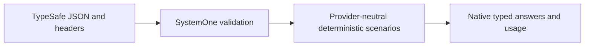

# Jev 1.14 native compatibility

In scope: the TypeSafe JSON SystemOne API, structured questions, base64 PNG/JPEG
assets, explicit image/long-context headers, and deterministic box fixtures.
Keep Kev, Cloudflare and OpenAI behavior isolated. Multipart and compression are
outside this change's claimed surface; production inference is never simulated.

References: [API](https://docs.typesafe.ai/api), [images](https://docs.typesafe.ai/images),
[box](https://docs.typesafe.ai/primitives/box), [models](https://docs.typesafe.ai/models).

## Implementation plan (step-by-step)

- [x] Add typed image/box contracts and deterministic box fixtures.
- [x] Validate the TypeSafe JSON request and experimental opt-ins at the HTTP boundary.
- [x] Cover mixed and box-only requests, references, header gates, malformed fixtures,
  structured criteria, failures and unaffected native providers.
- [x] Run formatting, Release build, full tests and provider contract/evidence checks.
- [ ] Review the combined batch, increment one patch version, push once and verify
  successful release plus actual NuGet availability before consumer updates.

The library claims the JSON upload surface only. It validates encoded file sizes,
reference use, PNG/JPEG metadata and dimension bounds, and rejects animated PNGs.
It does not run TypeSafe's image preprocessing, tokenizer, expanded-image memory
accounting or inference. Use explicit scenario usage and scripted provider failures
for context-limit tests; send the long-context header through the production client.
The 2026-10-15 combined repair targets one `0.1.15` release.

Local verification: Release solution build has zero warnings/errors; all 626 tests
passed, including the provider contract/evidence matrix. Coverlet reports 91.27%
total production line coverage and 96.76% for SystemOne. All 22 projects report no
known direct or transitive NuGet vulnerabilities. Formatting and diff checks passed.

