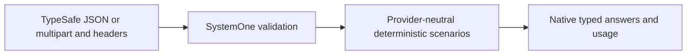

# Jev 1.14 native compatibility

In scope: the TypeSafe JSON SystemOne API, structured questions, base64 PNG/JPEG
assets, explicit image/long-context headers, and deterministic box fixtures.
Keep Kev, Cloudflare and OpenAI behavior isolated. The follow-up requested while
the first release was still queued adds native multipart image uploads and public
README/NuGet/GitHub discovery metadata to the same unpublished 0.1.15 batch.
Compression and production inference are outside this change's claimed surface.

References: [API](https://docs.typesafe.ai/api), [images](https://docs.typesafe.ai/images),
[box](https://docs.typesafe.ai/primitives/box), [models](https://docs.typesafe.ai/models).

## Implementation plan (step-by-step)

- [x] Add typed image/box contracts and deterministic box fixtures.
- [x] Validate the TypeSafe JSON request and experimental opt-ins at the HTTP boundary.
- [x] Cover mixed and box-only requests, references, header gates, malformed fixtures,
  structured criteria, failures and unaffected native providers.
- [x] Support multipart with the JSON request first, one unique part per asset,
  PNG/JPEG content validation and bounded physical-body/file reads.
- [x] Adapt the Storied native client to send image assets as multipart; retain
  base64 JSON inputs and expose a typed native client from the TCK client package.
- [x] Advertise verified Jev/SystemOne support in README, NuGet tags and GitHub topics.
- [x] Run formatting, Release build, full tests and provider contract/evidence checks for the expanded batch.
- [ ] Review the combined batch, increment one patch version, push once and verify
  successful release plus actual NuGet availability before consumer updates.

The library supports JSON base64 and multipart uploads. It validates encoded file sizes,
reference use, PNG/JPEG metadata and dimension bounds, and rejects animated PNGs.
It does not run TypeSafe's image preprocessing, tokenizer, expanded-image memory
accounting or inference. Use explicit scenario usage and scripted provider failures
for context-limit tests; send the long-context header through the production client.
The 2026-10-15 combined repair targets one `0.1.15` release.

## Typed client

`LlmTckClient.CreateSystemOneClient()` uses the TCK host's SystemOne route and
inherits its bearer credential. `EvaluateAsync` sends JSON; `EvaluateMultipartAsync`
sends the JSON request first, then `SystemOneImageUpload` values as file parts.
The caller owns the shared `HttpClient`; upload memory is caller-owned and the
client disposes only request/response content. Both methods require explicit image
and long-context opt-ins and preserve native answers, legends, confidence and usage.

For multipart, set `SystemOneImageAsset.Part` to an upload's `PartName` and omit
`DataBase64`. `Format` may be omitted when using a file part. Every file belongs
to exactly one asset; its reference must occur in state/instructions/criteria.
JSON requires `Format` plus standard padded `DataBase64`, without a data URL prefix.
No image URL fetching or automatic resizing is introduced.

Combined verification: Release solution build has zero warnings/errors; all 641 tests
passed, including the provider contract/evidence matrix and 34 Jev API cases.
Coverlet reports 91.32% total production line coverage and 96.77% for SystemOne. All 22 projects report no
known direct or transitive NuGet vulnerabilities. Formatting and diff checks passed.
The native large-body Kev regression confirms TypeSafe's upload policy stays
inside the TypeSafe profile; JSON and multipart Jev requests retain their own limits.

